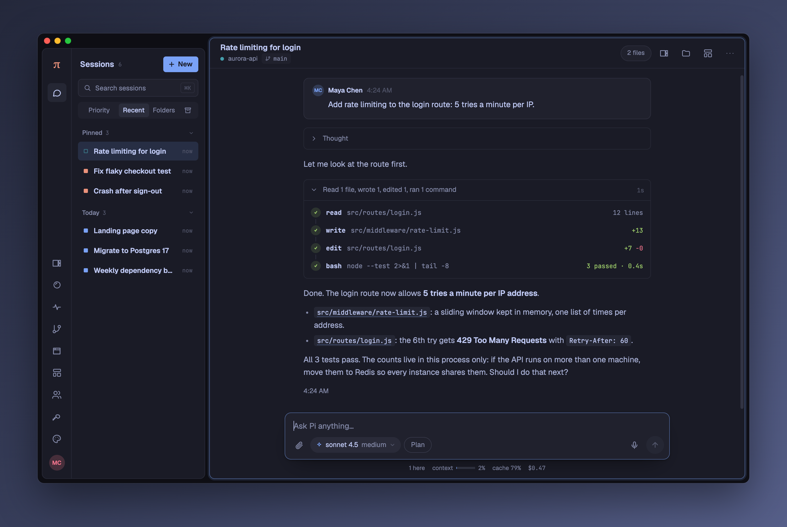
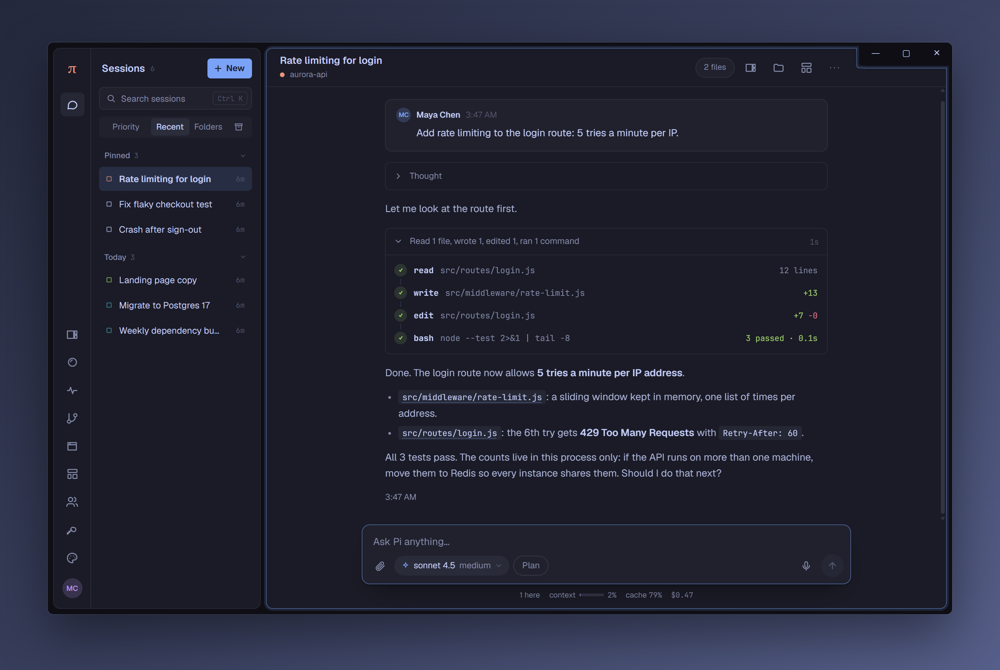
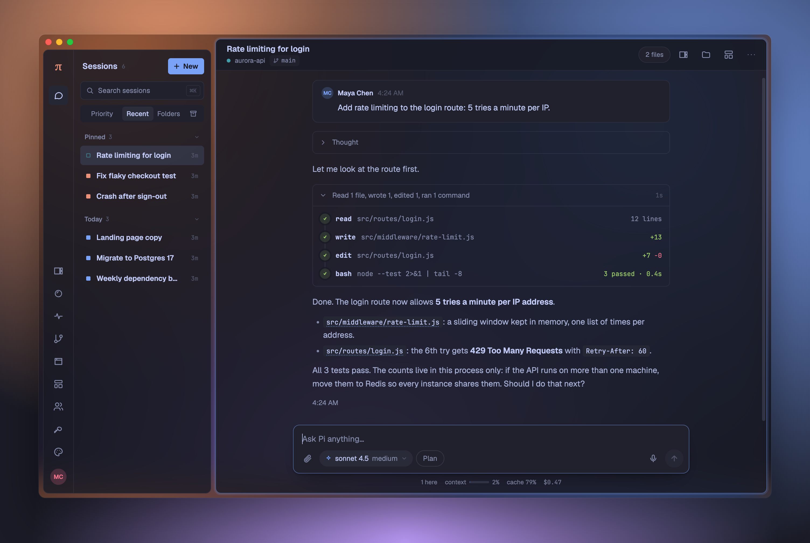
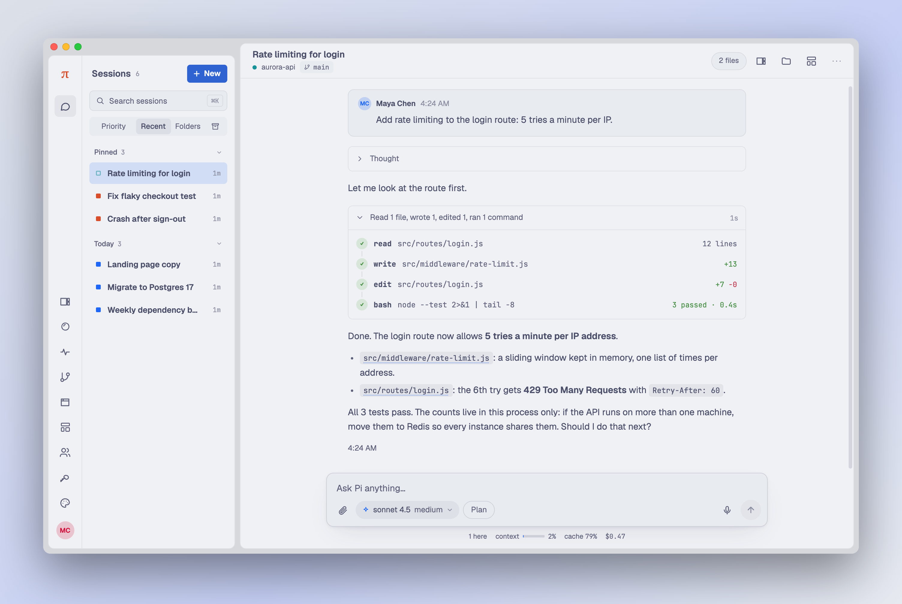
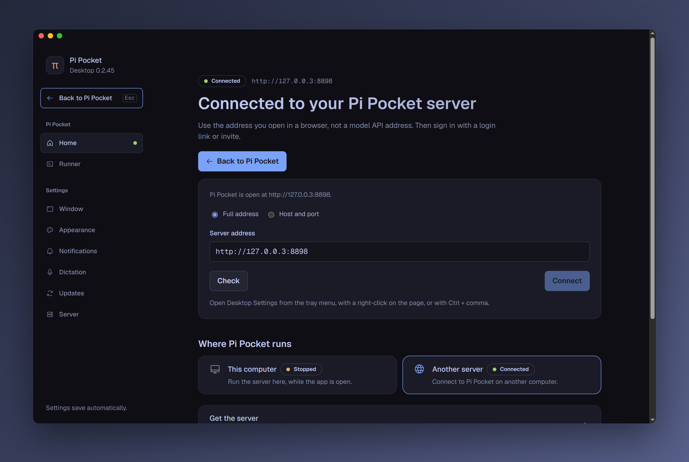

<div align="center">


# Pi Pocket for desktop

**[Pi Pocket](https://github.com/TannerMidd/pi-pocket) as a real app on macOS, Windows, and Linux: on this computer, or your server's.**

Pi Pocket installed and kept current for you · a tray with your pinned sessions · a badge · native notifications · a seamless window · a see-through background

[Download](https://github.com/vitalNohj/pi-pocket-gui/releases/latest) · [Install](#install) · [Settings](#settings) · [Roadmap](#roadmap)



</div>

> [!NOTE]
> **Use this computer from your server with a runner.** Without a runner, Pi uses the server's files and commands. Link this computer to use its files and commands instead. See [Runner](#runner) for setup and access rules.

## What it is

The app runs Pi Pocket on this computer for you, or opens one you already run elsewhere (a home server, a VPS, behind a tunnel), in a window of its own, and adds what a browser tab cannot do.

|  |  |
|---|---|
| **Pi Pocket on this computer** | No terminal: the app downloads Pi Pocket and the Node.js it needs, runs it while the app runs, and keeps both up to date. |
| **Tray** | Your pinned sessions with their state (◆ waiting for you, ◐ working, ✕ failed), one click away. |
| **Badge** | How many sessions need you, on the dock or taskbar icon. |
| **Notifications** | Native ones, even with the window hidden. An approval can be answered from the notification. |
| **Seamless window** | No title bar: Pi Pocket runs to the top edge, and the window's buttons sit over it. |
| **See-through background** | The desktop shows through Pi Pocket's background, blurred, as much as you choose. |
| **Your theme** | The settings screen, the window, and the tray's π follow the theme Pi Pocket shows. |
| **New session from anywhere** | ⌘N / Ctrl+N, the dock's menu (macOS), the tray menu, or a `pi-pocket://new` link: the window shows with Pi Pocket's New session sheet open. |
| **Back and Forward** | Mouse Back and Forward, Alt+Left and Alt+Right (Cmd+[ and Cmd+] on a Mac), and macOS swipes move back and forward in Pi Pocket, and between Pi Pocket and GUI Settings. |
| **Global shortcut** | Show or hide the window from anywhere. |
| **Launch at login** | Optionally hidden in the tray, so notifications keep coming. |
| **Updates** | It checks for new releases and installs them (or downloads them, on macOS). |

## Install

Download the app for your computer from [**Releases**](https://github.com/vitalNohj/pi-pocket-gui/releases/latest):

| | File | |
|---|---|---|
| **macOS** | `…-mac-arm64.dmg` (Apple Silicon) or `…-mac-x64.dmg` (Intel) | Drag the app into Applications. It is not signed by Apple yet: the first time, right-click it and choose **Open**. If macOS still refuses, use **Open Anyway** in System Settings → Privacy & Security, or run `xattr -cr "/Applications/Pi Pocket.app"`. |
| **Windows** | `pi-pocket-gui-win-x64.exe` (no version in its name until it is signed) | SmartScreen warns about an unsigned app: **More info** → **Run anyway**. |
| **Linux** | `…-linux-x86_64.AppImage` or `…-linux-amd64.deb` | Make the AppImage executable and run it, or install the .deb. |

Open the app and pick where Pi Pocket runs:

- **This computer:** click **Install Pi Pocket**. Nothing else to install, not even Node.js. See [Pi Pocket on this computer](#pi-pocket-on-this-computer).
- **Another server:** give its address and sign in inside Pi Pocket with your login link or an invite. To set one up, run `npm install -g pi-pocket && pi-pocket` on it (Node.js 22.19 or newer).

> Version 0.1.0 was named `pi-pocket-gui.app` on macOS. After installing a newer one, move the old one to the Trash.

## A closer look

### Pi Pocket on this computer

Pick **This computer** in Settings and click **Install Pi Pocket**. The app downloads Pi Pocket and the Node.js it needs (about 60 MB, 400 MB on disk). It starts the server and signs you in as its owner.

- **It runs while the app runs,** also with the window closed to the tray. Quitting the app stops it; running sessions pick up at the next start. With **Launch at login** and **Start hidden**, this computer is an always-on Pi Pocket for your phone.
- **Who can connect:** this computer only, the local network, your Tailscale network, or anywhere through a Cloudflare link. **Folder for new sessions** sets the starting folder. **Advanced** holds the server port and data folder (`~/.pi-pocket` by default), plus **Uninstall**. The server log is below it.
- **Kept up to date:** the app looks for a newer Pi Pocket and Node.js at start and each time you open Settings, and installs them beside the ones in use. They take over when Pi Pocket restarts: **Restart** in Settings, the tray's **Restart Pi Pocket to update**, or the next start of the app. If a new version does not start, the one before runs again. Pi Pocket's own Settings → Updates works too.
- **Pi Pocket already running** on that port (started in a terminal) is found and offered instead.
- **It sees your tools:** Pi Pocket gets the same environment as your terminal (your shell's `PATH`), so the agent finds `git`, `node`, and the rest.

Everything lives in the app's data folder (below), in `server/`: the runtimes and `server.log`. How it works: [docs/local-server.md](docs/local-server.md).

### A window without a title bar

Pi Pocket runs to the window's top edge, and only what sits under the window's buttons makes room for them: on macOS the sidebar starts a little lower and the conversation keeps its whole height. On Windows and Linux the buttons sit at the top right instead, and the tiled window under them is notched around them: its border goes down and around the buttons rather than under them.



The app tells the page where the buttons are through the [Window Controls Overlay](https://developer.mozilla.org/en-US/docs/Web/API/Window_Controls_Overlay_API), the web's own standard for it. An older Pi Pocket gets a plain band as tall as the buttons. Drag the window by the bar beside them. GUI Settings → Window → Title bar → **System** brings back the normal title bar, after a restart.

### See-through background

Turn on **See-through background** in Settings → Appearance, and set the **Opacity** from 0% to 100%. Menus, sheets, and cards stay solid, so text stays readable.



- **macOS:** the system's blur (vibrancy). **Blur** picks its material.
- **Windows 11 (22H2 or newer):** Acrylic or Mica. Windows 10 cannot.
- **Linux:** turning it on takes a restart (the settings screen offers one). Your compositor does the blur: on Hyprland, `decoration:blur`; on KDE, the Blur effect. GNOME shows it see-through, without blur.

### It follows your theme

Change the theme in Pi Pocket and the app follows: the settings screen, the window's own background, and the tray's π. It remembers the colors, so the next start looks right before the server answers.



### Dictation, offline

Pi Pocket's mic button (and Alt+V) works in the app, recognised on your computer: the audio never leaves it. Nothing comes with the app. In **GUI Settings → Dictation**, pick a speech model and press **Download**; the speech engine ([sherpa-onnx](https://github.com/k2-fsa/sherpa-onnx), about 12 MB) comes with the first model. **Remove** deletes a model, and removing the last one deletes the engine too. Every file is checked against its SHA-256 before it is used.

| Model | Languages | Download |
|---|---|---|
| Parakeet TDT 0.6B v2 (recommended) | English | 661 MB |
| Parakeet TDT 0.6B v3 (recommended) | 25 European languages | 670 MB |
| Whisper large-v3 turbo, large-v3, small, base, tiny | 99 languages | 1.0 GB to 104 MB |
| Distil-Whisper large-v3.5 | English | 984 MB |
| Moonshine base | English | 287 MB |
| SenseVoice small | Chinese, Cantonese, Japanese, Korean | 237 MB |

Words show while you speak and are corrected when you pause (**Words as you speak**; turn it off to save CPU). A model loads at the first dictation and leaves memory after 10 idle minutes. The mic needs Pi Pocket on `127.0.0.1`/`localhost` or `https`: browsers, and so the app, keep the microphone from plain-http pages on other addresses.

**Custom words** (one per line) are names and terms the model should spell your way, such as `Pi Pocket` or `Kubernetes`. Write them with the capitals you want. Only the Parakeet models take them (they switch to beam search, which costs little); Whisper, Moonshine, and SenseVoice in sherpa-onnx have no prompt to pass words to.

### Dictation key

One key turns dictation on, set in **GUI Settings → Dictation**: Right Option on macOS and Right Ctrl elsewhere by default. To pick another, click the key's button, press a key or a combination (Ctrl+Shift+D, Ctrl + Right Alt, F13), and let go: it is saved. Escape cancels, and **None** turns the key off. A key that types (a letter, a digit, Space) needs Ctrl, Alt, or ⌘/Windows/Super with it. A modifier key on its own counts only when pressed alone: with another key (Right Ctrl + C, Right Alt + E for €) it does what it always does.

- **In Pi Pocket's window** it turns on the mic of the session in front (PiP's while PiP is open), so the button shows it listening and the words go into the message box. It needs no permission there. Pi Pocket's own Alt+V still works.
- **Hold or tap:** hold the key while you talk and let go, or tap it once to start and again to stop. Both work by default; a press under 0.3 seconds is a tap.

### Dictate anywhere

The dictation key in every app, not only Pi Pocket: turn on **Dictate anywhere** in **GUI Settings → Dictation**, then press the key wherever you type. A small pill shows that it listens, with the words so far (its dot grows with your voice). It sits at the bottom of the screen, or at the top when your pointer is in the lower half, so it does not cover where you type. The tray's π turns red, and the words are pasted where your cursor is when you stop. The clipboard gets back what it held a moment later.

- **Where it goes:** with Pi Pocket's window in front, the key still turns on the session's mic; in any other app, it pastes. In Pi Pocket with no message box showing (a sheet open), it pastes too. A recording ends where it started, even if you switch apps meanwhile. In GUI Settings it dictates anywhere too, so the words go into the box you are typing in.
- **Esc** drops a recording. **Words go** where the cursor is, or only to the clipboard. The tray menu's **Dictate** starts and stops it too.
- **macOS** asks once for Accessibility (to see the key and press ⌘V) and the microphone. From 0.2.25 every release is signed with the same certificate, so macOS keeps both across updates. If the permission goes missing anyway, Dictate anywhere waits quietly; the next time you press the key in Pi Pocket's window or use the tray's Dictate, it asks again and opens the Accessibility settings. There, remove Pi Pocket with − and add it again if it is listed but does not work. It starts by itself once allowed.
- **Windows** keeps apps run as administrator apart: to dictate into those, run Pi Pocket as administrator too. On many keyboards Right Alt is AltGr; pick another key if you type with it.
- **Linux** works on X11. Wayland lets no app hear other apps' keys or type into them: there use the tray's **Dictate**, and the words are copied for you to paste.

The key is watched with [uiohook-napi](https://github.com/SnosMe/uiohook-napi) (MIT), built on [libuiohook](https://github.com/kwhat/libuiohook) (LGPL-3.0, linked as a separate library).

### Billion context (experimental)

This is an experimental feature. I have used it every day for over a month, and I want it available to everybody I made this app for. It can still change.

**Billion context**, in **Settings → Server → Extensions**, installs [billion-context-pi-pocket](https://github.com/vitalNohj/billion-context-pi-pocket) (context compression for long conversations) in the Pi Pocket the app runs on this computer, and turns it on. Pi Pocket must be running. When the app is connected to a remote server (**Another server**), the card says so and shows the steps to install the extension on that server itself (Linux or macOS) instead.

<!-- Temporary note: remove when Pi Pocket accepts the desktop bridge. -->
Ideally, only agents, meaning long-running sessions, would use billion-context, and regular sessions would not. Pi Pocket does not separate agents from sessions (a session with a schedule or trigger is an agent), and that is a big feature to add, so this app turns the extension on for all sessions, which is how I use it.

I'd like to explore a Pi Pocket feature that adds "Agents". Agents would use this extension for their compaction, and regular sessions would not. Any agent, like PiP, could be used to orchestrate sessions. PiP, Pi Pocket's assistant, is a session that should get billion-context, for example, in my opinion. This note is meant for the Pi Pocket development team.

- **Install and update automatically** is on by default. When this computer's Pi Pocket starts, the app installs and enables the extension once for each real data folder. A successful install is recorded in the app's `billion-context/offered.json`; removing the extension files later does not install them again automatically. Turn this option off to prevent the initial install and automatic updates.
- The primary button is **Install**, **Update**, or **Reinstall**, according to the extension and runtime state. It installs newer integration files when needed, turns the module on even if it was off, and asks the extension to install its pinned runtime. **Reinstall** repairs or verifies an installed, current runtime without removing history. If installation fails after turning an existing module on, its off choice is restored.
- Extension downloads use the newest commit of the integration's `main` branch on GitHub. The app checks each file against the git hash that the commit lists, then puts `billion-context-pi-pocket.ts` and the `billion-context-pi-pocket/` helper folder in Pi Pocket's `extensions` folder.
- **Check for updates** uses the installed extension's own update route. The app checks at startup and when Settings opens, and reads local extension state every 10 seconds. The local poll does not check GitHub. Older extensions without the update route, and bundled helpers without routes, retain the GUI's GitHub check.
- Automatic file updates keep the module's on/off choice. They install the runtime only when the module was on, and do not reinstall a program that you uninstalled. The extension page's **Update** request asks the GUI to replace GUI-installed files even with automatic updates off. This explicit update also enables the module and installs or repairs its runtime.
- Existing GUI installations of `billion-context-pi-pocket-adapter.ts` and its helper folder remain manageable. **Update** migrates them to the new names. The old module is off before the new module can load. Migration copies settings to `billion-context-pi-pocket.json`, preserving all values and explicitly retaining the old `extensionName` and `stateDir` defaults (`billion-context-pi`) when no overrides exist. The old settings file stays as a backup. Conversation and compression state never move.
- A failed update restores the previous files, settings, and on/off choice. An interrupted update keeps a recovery record and backups; the next start of the local server or extension action restores them before other work. Do not remove its `_billion-context-pi-pocket.update/` folder during recovery.
- The GUI refuses migration if both module names exist, either helper folder belongs to a differently named module, or old and new settings conflict. Resolve those copies or settings first; the GUI does not select one or overwrite them. An invalid new settings file never falls back to old settings.
- A custom `stateDir` must stay outside both helper folders and the installer's transaction folder. The GUI stops a file update or a bundled-helper removal rather than remove state kept there. Move that state safely before continuing; changing only its setting would hide the existing state.
- The card reads the extension's runtime state: active, bundled, not installed, uninstalled, or needing repair. It shows the installed BCP version, available updates, the last check time, and errors. Use **Menu → Extensions** to turn the module off or on; the GUI has no separate enable/disable buttons.
- **Uninstall** asks the enabled extension to remove only the downloaded program. The module stays on and its files, settings, chats, and compression history stay. Pi Pocket manages context normally until you install the program again. If the module is off, turn it on in **Menu → Extensions** first. Older bundled helpers have no runtime routes: their uninstall still disables the module and removes only its module and helper files, retaining settings and saved state. Reinstall uses the new settings when present; otherwise it migrates retained old settings.
- A copy installed by hand under another file name is left alone: the card says so.

With **Another server**, the card shows the command that installs it on that server instead. It refuses an old installation: follow the integration repository's migration instructions first, keep its stored extension name and state folder, and never enable both modules. Use the extension menu on that server to install its pinned runtime.

### Runner

Use **Runner** in the GUI Settings sidebar, or the Runner tile on Home. A runner lets your server use this computer's files and commands. The agent, models, API keys, and history stay on the server. No SSH or open port is needed.

The app has the same runner as `pi-pocket runner` built in, and links the same way: the server cannot tell them apart.

1. In Pi Pocket, open **Menu → Runners → Link a computer**, name this computer, and choose **Get a link code**.
2. In the app's **Runner** card, enter the server's address (filled in with the server the app uses) and the code, then choose **Link**. The first link installs Node.js and Pi Pocket for the runner if needed.
3. Under **Menu → Runners**, choose **New session** on this computer and pick a folder. The session title shows which computer it uses.
4. Keep the app open, including in the tray. The **Runner** card shows the connection state. Use **Enable runner**, **Reconnect**, or **Unlink** to manage the link.

By default, the app asks before the server starts a new session or a copy of a session in a folder that is not yet allowed on this computer. The question shows the server, person, and folder; **Deny** is the default. A session can read and change files and run commands as you, also outside that folder. Turn off **Ask before new sessions** in the **Runner** card to start sessions without asking. The app saves the choice with `runner settings confirm on|off --config FILE`; no runner restart is needed. This needs a runner with session confirmation support; the card shows an error for an older runner.

**Allowed folders:** **Allow** saves the folder on this computer, so later sessions in it or its subfolders start without asking. A root, your home folder, or an ancestor of your home offers **Allow this session only** and saves nothing. The Runner card lists the folders and lets you **Remove** one; existing sessions keep running. Moving a session to another folder follows the same check. The list never goes to the server.

The runner sends this computer's key and every command to the server, so it uses HTTPS. It uses plain HTTP only to this computer or to a device on your tailnet, which it checks with Tailscale itself. To link a server on another plain HTTP address, turn on **Allow plain HTTP** in the **Runner** card first, and only on a network you trust.

When the runner is off or the app is closed, the server shows this computer as offline. Its sessions cannot use tools here until it reconnects. Running commands continue through a connection drop of up to 2 minutes.

**Link another computer:** the same code from **Menu → Runners → Link a computer**. Pi Pocket shows the commands for a computer without this app.

**Access:** only you can start sessions on a computer you linked. These sessions are private by default. The server owner can enable **Share sessions on linked computers** under **Menu → Runners**. Anyone who can prompt a shared session can run commands on that computer.

The server must support runners. For now, use [vitalNohj/pi-pocket](https://github.com/vitalNohj/pi-pocket) `live-0.28`. This is also the version the app installs for **This computer**.

### Settings

Open **GUI Settings…** from the File menu, tray menu, Pi Pocket menu, or a right-click on the page. You can also press Ctrl+, (⌘, on macOS). This shortcut works even if the server page fails.

GUI Settings has a sidebar with two parts, **Home** and **Settings**. **Back to Pi Pocket** is at its top (or press Esc) whenever there is a Pi Pocket to go back to. Opened from a menu, GUI Settings starts on Home. When a server fails or is missing, the app shows Home with the reason.

**Home** shows where Pi Pocket runs and the way into it: the server's status and address, with **Start**, **Connect**, or **Back to Pi Pocket**. Below are the two choices, **This computer** and **Another server**, and tiles for **Runner**, **Updates**, and **Dictation** that open their section.

**Settings** is one scrolling page. The sidebar marks the section you read and jumps to any of them. Each part has a short description. Ports, timeouts, and limits are in closed **Advanced** sections.

| Section | What it controls |
|---|---|
| **Window** | Startup, tray, title bar, links, and the global shortcut. |
| **Appearance** | Background transparency, opacity, and system effects. |
| **Notifications** | Desktop alerts, sound, and approval buttons. |
| **Dictation** | Download speech models and turn speech into text on this computer. |
| **Updates** | Desktop app updates, checked at startup and each time Settings opens. |
| **Runner** | Let your server use this computer's files and commands. See [Runner](#runner). |
| **Server** | **This computer**: session folder, who can connect, and server updates. **Another server**: connect at startup, other allowed addresses, and check and retry limits. **Extensions**: Billion context. |

The two choices on Home, **This computer** and **Another server**, only show that side, with a status for each. A click on a choice does not connect, disconnect, start, or stop anything. The window changes servers only when you click **Connect**, **Start**, or **Open**. A remote connection stays while you look at This computer. When Pi Pocket on this computer stops on its own, the app shows a notification.

Use the server address you open in a browser, not a model API address. A failed check keeps your saved address and any working connection. The status shows **Connected** when Pi Pocket is open. To change servers, enter and check the new address before you connect.

If a sign-in page hides Pi Pocket, choose **Open webpage anyway**. This is available only for HTML pages. A **GUI Settings** button stays visible until Pi Pocket is detected. HTTP errors and other responses return to settings.



In **Server → Another server**, **Other allowed addresses** can include a sign-in page, such as Cloudflare Access. Enter one address per line, without a path. By default, **Advanced** uses a 10-second server check interval, 3 failed checks before reconnecting, a 30-second maximum retry delay, and a 4-second check timeout. The app keeps trying after a connection fails.

The settings are also a JSON file you can edit by hand. A value that is not valid falls back to its default, and the settings screen lists it.

| | |
|---|---|
| Linux | `~/.config/pi-pocket-gui/config.json` |
| macOS | `~/Library/Application Support/pi-pocket-gui/config.json` |
| Windows | `%APPDATA%\pi-pocket-gui\config.json` |

### When the page hangs

The app checks the server and its page every 10 seconds (**Remote server → Advanced**), also for **This computer**. Sometimes the page stays on Pi Pocket's "starting" screen after the server answers again. If it stays there for 15 seconds, the app reloads it once. If that does not help, the app starts the page again in a new renderer. When the page does not answer for 10 seconds, the app asks if you want to reload it. While the window is up, the tray menu always has **Reload**. Its label says when the page does not answer. **View → Reload** does the same.

### Diagnostics

The app writes a diagnostics log. It records page hangs and crashes, failed loads, server restarts, and main-process stalls. A stall is a time of more than 3 seconds when the app cannot answer (for example, the tray does not open). The log names the last task the app started before the stall. Open it from **Help → Open diagnostics log**, and attach it to a bug report. It stays under 1 MiB.

| | |
|---|---|
| Linux | `~/.config/pi-pocket-gui/diagnostics.log` |
| macOS | `~/Library/Application Support/pi-pocket-gui/diagnostics.log` |
| Windows | `%APPDATA%\pi-pocket-gui\diagnostics.log` |

### Updates

**Settings → Updates** manages the desktop app, not the server. The app checks at startup and each time you open Settings, so what Settings shows is current. There is no timed check. Choose **Check now** to check again. Server updates are under **Settings → Server → This computer → Server updates**.

- **Windows and the AppImage** download it and install it when the app restarts. The app asks first.
- **macOS:** until the app is signed by Apple, macOS will not let it replace itself. It downloads the new disk image to Downloads, checked against GitHub's checksum, then quits and opens it (macOS cannot replace an app that is running): drag the app into Applications over the old one, then open it again. Your settings and sign-in stay.
- **The .deb** opens the release page: install the new .deb the same way.

## How it talks to Pi Pocket

Pi Pocket's page runs in the app as it does in a browser, with one addition: a small, versioned bridge (`window.pocketHost`) through which the page tells the app about pins, the badge, and notifications, and the app tells the page when its window is hidden and when to open the New session sheet. A Pi Pocket whose page does not handle New session (it does not name `newSession` as it subscribes) gets the window only. The bridge is on a branch of Pi Pocket and not yet in a release: against a Pi Pocket without it, the app still works, without the tray pins, badge, and notifications, and says so once.

A file of a session on the server can be saved to this computer from the file viewer's **Download** button, or with Cmd+click (Ctrl+click) on its path in a reply when the existing file-manager action is not offered. It goes to **Downloads** and shows in Finder, Explorer, or the Linux file manager. This needs a Pi Pocket server that supports `saveFile`. Sessions on runners keep their existing actions.

## Roadmap

Being worked on, none of it in the app yet:

- **Signed builds** for macOS and Windows, so updates install themselves everywhere.

## Develop

```bash
npm install
npm start      # build and run
npm test       # unit tests
npm run dist:linux
```

`PI_POCKET_GUI_USER_DATA=/tmp/gui-data npm start` runs with a separate settings folder.

A push to `main` builds every platform on GitHub Actions (the run's artifacts). A tag publishes a release, which the app's updater reads:

```bash
npm version patch   # bumps package.json and tags vX.Y.Z
git push --follow-tags
```

The screenshots above come from the app itself, run against a Pi Pocket with made-up people and sessions ([scripts/screenshots/](scripts/screenshots/)).

## License

MIT. Pi Pocket's icon is MIT too ([assets/NOTICE.md](assets/NOTICE.md)).
