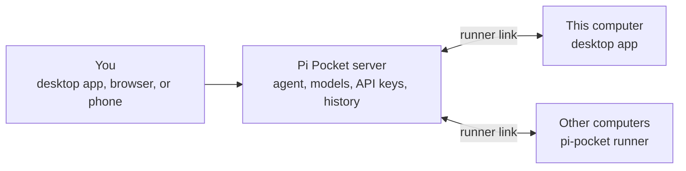

<div align="center">


# Pi Pocket Desktop

**The desktop app for [Pi Pocket](https://github.com/TannerMidd/pi-pocket) on macOS, Windows, and Linux.**

Run Pi Pocket on your own computer, connect to a Pi Pocket server anywhere, or let a server work on this computer's files.

[Download](https://github.com/vitalNohj/pi-pocket-desktop/releases/latest) · [Features](#features) · [Where Pi Pocket runs](#where-pi-pocket-runs) · [Install](#install) · [Documentation](#documentation)


</div>

## Features

Everything Pi Pocket does in a browser works the same way here. The app adds:

### Servers

- **One-click local server.** The app installs Pi Pocket and Node.js for you, and runs the server while the app is open. No terminal needed.
- **Server updates with rollback.** Pi Pocket and Node.js stay up to date. If a new version does not start, the previous version runs again.
- **Your tools work.** The local server gets your terminal's `PATH`, so the agent finds `git`, `node`, and your other tools.
- **Use it from your phone.** Choose who can connect to the local server: this computer only, your local network, your Tailscale network, or anyone through a Cloudflare link.
- **Connect to any server.** A home server, a VPS, or a server behind Tailscale, a Cloudflare tunnel, or a Cloudflare Access sign-in.
- **Automatic reconnect.** The app checks the server and reconnects after a network drop or a server restart.
- **Built-in runner.** A Pi Pocket server can use this computer's files and commands. See [Runners](#runners).

### Tray, badge, and notifications

- **Pinned sessions in the tray**, with their state: waiting for you, working, or failed. One click opens a session.
- **Tray actions:** open Pi Pocket, start a new session, dictate, copy your last dictation, reload the page, and install updates.
- **Styled tray menu on Windows**, in the Windows look or your Pi Pocket theme, with full keyboard support.
- **Badge** on the dock or taskbar icon that counts the sessions that need you.
- **Native notifications**, also when the window is hidden in the tray.
- **Approve from a notification.** Allow or deny Pi's request without opening the app. By default, **Allow** shows only when the full command is visible.
- **Fewer notifications.** Sessions that finish together share one notification. While you are away, notifications wait and show once when you return.

### Window

- **No title bar.** Pi Pocket fills the window, and the window buttons sit on top of the page. On Windows and Linux, the panel under the buttons is notched around them, and menus and panels keep clear of them.
- **See-through background** with the system's blur: vibrancy on macOS, Acrylic or Mica on Windows 11, and your compositor's blur on Linux. Set the opacity from 0% to 100%.
- **Follows your Pi Pocket theme:** Desktop Settings, the window background, the tray icon, the right-click menu, and the window buttons on Windows.
- **Remembers its size and position**, including maximized.
- **Close to tray.** Closing the window keeps the app running, so notifications keep coming.
- **One app at a time.** Opening the app again brings back the window that is already open.

### Typing and editing

- **Spell check** in every text box, with suggestions in the right-click menu. Add a word to the dictionary, and it is never marked again.
- **Themed right-click menu**, styled like Pi Pocket's own menus, with cut, copy, paste, and select all where they apply.

### Links and files

- **Session links stay in the window.** A link to another session opens it in the same window. ⌘-click, Ctrl-click, or Shift-click opens a new window.
- **Other websites open in your browser.** You choose whether server pages, such as artifacts, open in an app window or in your browser.
- **Save server files** straight to your Downloads folder, without a save dialog: the file viewer's **Download** button, or Cmd+click (Ctrl+click) on a file path in a reply.

### Voice

- **Offline dictation.** Speech is recognized on your computer and never leaves it. Choose a Parakeet, Whisper, Moonshine, or SenseVoice model, in up to 99 languages.
- **Words as you speak.** Your words show while you talk and are corrected when you pause.
- **Dictation key.** Choose any key or combination. Hold it while you talk, or tap it to start and stop.
- **Dictate into any text box in Pi Pocket:** the message box, a search box, or your answer to Pi's question.
- **Dictate anywhere.** The same key types your words into any app. A small pill shows what the app hears, and your clipboard comes back after the paste.
- **Recent dictations.** Copy any of your last 5 dictations again, from Desktop Settings or the tray.
- **Custom words**, so that names and terms are spelled your way.

### Shortcuts

- **New session from anywhere:** Ctrl+N (⌘N on macOS), the tray menu, the dock menu, or a `pi-pocket://new` link.
- **Global shortcut** to show or hide the window from any app.
- **Back and forward** with the mouse buttons, Alt+Left and Alt+Right (⌘[ and ⌘] on macOS), or trackpad swipes on macOS.
- **Desktop Settings** with Ctrl+, (⌘, on macOS), also from Pi Pocket's menu, the tray, and the right-click menu.

### Reliability

- **Page recovery.** A page stuck on the starting screen reloads by itself. A **Reload** button appears when loading takes more than 3 seconds, and a page that stops responding offers a reload.
- **Settings always open.** Desktop Settings opens also when the server is down, and shows the reason.
- **Diagnostics log** of page hangs, crashes, and slowdowns, to attach to bug reports.

### Startup and updates

- **Launch at login**, optionally hidden in the tray.
- **Automatic app updates.** On Windows and Linux (AppImage), updates install when the app restarts. On macOS, the app downloads the update for you.

### Privacy and safety

- **Private speech.** Dictation runs on your computer, and the audio never leaves it.
- **Limited page access.** Only the server's own page gets permissions, such as the microphone, notifications, and the clipboard. Pages from other addresses open in your browser.
- **You approve runner sessions.** A server cannot start a session on this computer in a new folder without your answer.

### Experimental

- **Billion context.** One-click install of context compression for long conversations.

## Where Pi Pocket runs

Pi Pocket is a server with a web app. The desktop app can run that server for you, open one that runs somewhere else, and act as a runner for a server.

| | What it does | Good for |
|---|---|---|
| **This computer** | The app installs and runs the Pi Pocket server on this computer. | A personal setup. Your phone can connect over your local network, Tailscale, or a Cloudflare link. |
| **Another server** | The app opens a Pi Pocket server that runs somewhere else. | A server that is always on, or that you share with other people. |
| **Runner** | A server uses this computer's files and commands. The agent, models, API keys, and history stay on the server. | Working on this computer's projects from a server, or from your phone through it. |

### Runners

A runner lets a Pi Pocket server work on another computer. Sessions read and write files, run commands, and use git on that computer. Pi, its models, and your API keys stay on the server. The runner connects out to the server, so the computer needs no open port and no SSH.



- **Link this computer.** In Pi Pocket, open **Menu → Runners → Link a computer** and get a link code. In the app, open **Desktop Settings → Runner**, enter the server address and the code, and choose **Link**.
- **Link other computers.** The same **Link a computer** screen shows the commands that install and link the runner on a computer without the app.
- **Keep a runner always on.** `pi-pocket runner service` runs the runner as a systemd user service on Linux, or starts it at sign-in on Windows and macOS. It needs an authenticator app, so you can approve sessions from Pi Pocket.
- **Stay in control.** The computer asks before a session starts in a folder that you have not allowed. The list of allowed folders stays on the computer, never on the server. Sessions on a linked computer are private to you unless the server owner turns on sharing.

> [!WARNING]
> A linked computer trusts its server fully. Sessions run commands as your user, with access to everything you can reach. Nothing runs in a sandbox. Link only to a server you trust.

Runners need a server with runner support. See [Server compatibility](#server-compatibility). Setup, approvals, and access rules: [docs/runner.md](docs/runner.md).

## Install

Download the app from [**Releases**](https://github.com/vitalNohj/pi-pocket-desktop/releases/latest).

| System | File | First launch |
|---|---|---|
| **Windows** | `pi-pocket-gui-win-x64.exe` | The app is not code-signed yet. If SmartScreen warns you, choose **More info → Run anyway**. |
| **macOS** | `…-mac-arm64.dmg` (Apple Silicon) or `…-mac-x64.dmg` (Intel) | Drag the app into Applications. It is not signed by Apple yet, so right-click it and choose **Open** the first time. If macOS still refuses, choose **Open Anyway** in System Settings → Privacy & Security, or run `xattr -cr "/Applications/Pi Pocket.app"`. |
| **Linux** | `…-linux-x86_64.AppImage` or `…-linux-amd64.deb` | Make the AppImage executable and run it, or install the .deb. |

Open the app and choose where Pi Pocket runs:

- **This computer:** choose **Install Pi Pocket**. The app downloads everything it needs, Node.js included (about 60 MB).
- **Another server:** enter the server's address, then sign in with your login link or an invite. To set up a server, run `npm install -g pi-pocket && pi-pocket` on it (Node.js 22.19 or newer).

### Server compatibility

| Server | What works |
|---|---|
| [vitalNohj/pi-pocket](https://github.com/vitalNohj/pi-pocket/tree/live-0.28) `live-0.28` | Everything. The app installs this build for **This computer**. |
| Pi Pocket 0.28.0 or newer | Everything except runners, **New session** from the app, and saving server files. |
| Older Pi Pocket | The window only: no tray sessions, badge, or notifications. |

## Screenshots

| | |
|---|---|
|  |  |
| Windows 11 | Linux |
|  |  |
| See-through background (Windows 11, Acrylic) | A light theme |

<details>
<summary><strong>More screenshots</strong></summary>

<br>

**macOS**

| | |
|---|---|
|  |  |
| The session menu | The People panel |
|  |  |
| Files and Changes | See-through background |

**Windows**

| | |
|---|---|
|  |  |
| The session menu | The People panel |
|  |  |
| Files and Changes | Desktop Settings |

**Linux**

| | |
|---|---|
|  |  |
| The session menu | The People panel |
|  |  |
| Files and Changes | Desktop Settings |

</details>

## Documentation

- [Guide](docs/guide.md): the local server, notifications, the window, spell check, links, shortcuts, Desktop Settings, updates, and troubleshooting.
- [Runner](docs/runner.md): link computers, approve sessions, and control access.
- [Dictation](docs/dictation.md): speech models, the dictation key, and Dictate anywhere.
- [Billion context](docs/billion-context.md): the experimental context compression extension.

## Roadmap

- **Signed builds** for macOS and Windows, so that updates install themselves on every system.

## For developers

The app is built with Electron and TypeScript. Pi Pocket's web app runs in the window as it does in a browser. A small, versioned bridge, `window.pocketHost`, lets the page and the app share pinned sessions, the badge, notifications, and window visibility. Pi Pocket documents it in [docs/embedders.md](https://github.com/TannerMidd/pi-pocket/blob/main/docs/embedders.md).

```bash
npm install
npm start            # build and run
npm test             # unit tests
npm run dist:linux   # Linux packages (also dist:mac and dist:win)
```

- `PI_POCKET_GUI_USER_DATA=/tmp/gui-data npm start` runs the app with a separate settings folder.
- Every push to `main` builds all platforms on GitHub Actions. A version tag publishes a release, which the app's updater reads:

    ```bash
    npm version patch   # bumps package.json and tags vX.Y.Z
    git push --follow-tags
    ```

- The screenshots come from the app itself, run against a demo server with made-up people and sessions: [scripts/screenshots/](scripts/screenshots/).
- How the app installs and updates the local server: [docs/local-server.md](docs/local-server.md).

## License

MIT. Pi Pocket's icon is MIT too ([assets/NOTICE.md](assets/NOTICE.md)).
