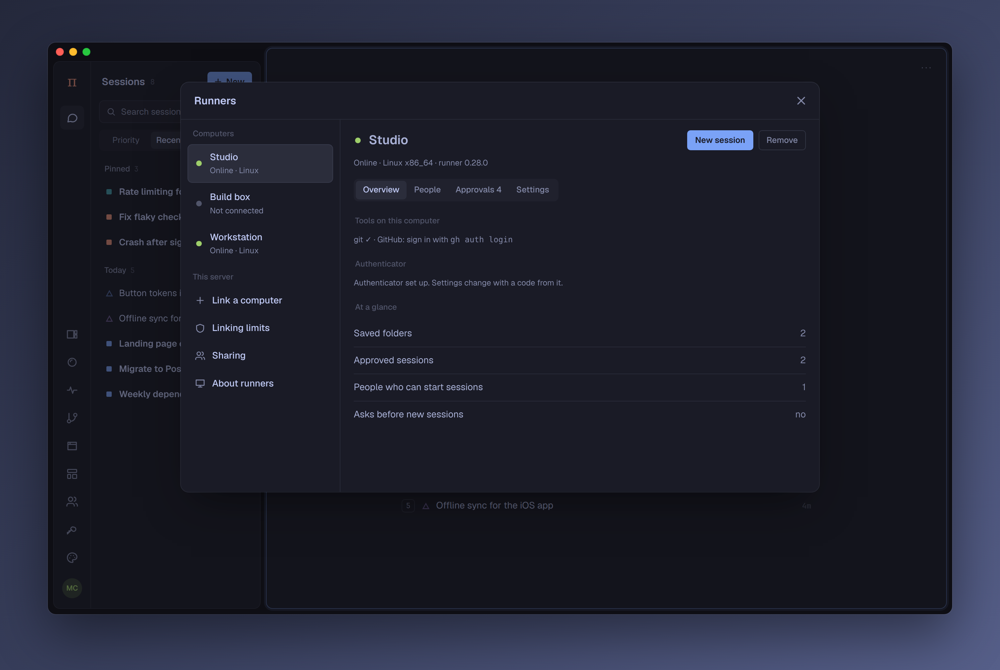
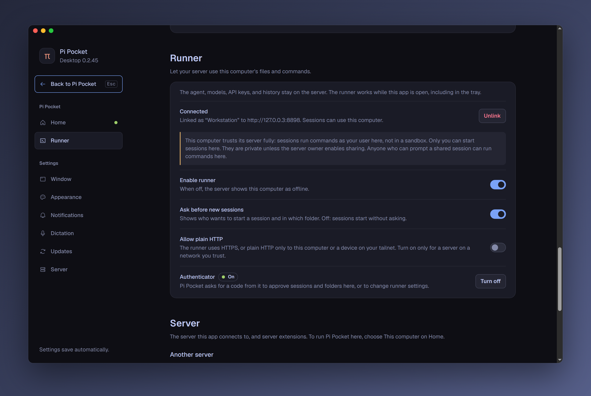

<div align="center">


# Pi Pocket Desktop

**The desktop app for [Pi Pocket](https://github.com/TannerMidd/pi-pocket), on macOS, Windows, and Linux.**

Run Pi Pocket on this computer or open your server's, keep your sessions in the tray, dictate offline,<br />
and let your server work on this computer's files with the built-in runner.

[**Download**](https://github.com/vitalNohj/pi-pocket-desktop/releases/latest) · [What it does](#what-it-does) · [Install](#install) · [The runner](#the-runner) · [More](#more)


</div>

## What it does

Everything Pi Pocket does in a browser works the same here. The app adds what a browser tab cannot do.

**The app itself**

- **Seamless window.** No title bar: Pi Pocket runs to the top edge, and the window's buttons sit over it.
- **See-through background**, blurred by the system, as much as you choose.
- **Follows your theme:** the settings screen, the window, the right-click menu, and the tray's π.
- **Global shortcut** to show or hide the window, and **Back and Forward** with the mouse, keys, or swipes.
- **Launch at login**, optionally hidden in the tray, and **updates** that install themselves (downloaded for you on macOS).

**Working with Pi Pocket**

- **Pi Pocket on this computer.** No terminal: the app installs Pi Pocket and Node.js, runs it, and keeps it current.
  You choose who can connect: this computer, your network, Tailscale, or anywhere through Cloudflare.
- **Or another server:** a home server, a VPS, behind Tailscale, a tunnel, or a sign-in page.
- **Tray** with your pinned sessions and their state, one click away.
- **Badge** on the dock or taskbar: how many sessions need you.
- **Notifications**, also with the window hidden. Approve or deny a request from the notification.
- **New session from anywhere:** ⌘N / Ctrl+N, the tray or dock menu, or a `pi-pocket://new` link.
- **Download to this computer:** a session's files go straight to your Downloads folder.

**The runner**

- **Your server, this computer's files.** A Pi Pocket server runs sessions here, on your files and tools, while the
  agent and its keys stay on the server. No SSH, no open port.
- **You approve** each new session and folder, here or with a code from your authenticator app.

**Dictation**

- **Offline.** Speech is recognised on this computer and never leaves it. Parakeet, Whisper, Moonshine, or SenseVoice,
  in up to 99 languages.
- **A dictation key**, hold to talk or tap to start and stop, and **Dictate anywhere**, in every app.

**Extensions**

- **Billion context** (experimental): context compression for long conversations, installed and kept current for you.

## Install

Download the app for your computer from [**Releases**](https://github.com/vitalNohj/pi-pocket-desktop/releases/latest):

|             | File                                                                                             |
| ----------- | ------------------------------------------------------------------------------------------------ |
| **macOS**   | `pi-pocket-desktop-…-mac-arm64.dmg` (Apple Silicon) or `pi-pocket-desktop-…-mac-x64.dmg` (Intel) |
| **Windows** | `pi-pocket-gui-win-x64.exe` (no version in its name until it is signed)                          |
| **Linux**   | `pi-pocket-desktop-…-linux-x86_64.AppImage` or `pi-pocket-desktop-…-linux-amd64.deb`             |

The app is not signed yet, so the first start needs one more step:

- **macOS:** drag the app into Applications. The first time, right-click it and choose **Open**. If macOS still
  refuses, use **Open Anyway** in System Settings → Privacy & Security, or run `xattr -cr "/Applications/Pi Pocket.app"`.
- **Windows:** SmartScreen warns about an unsigned app: **More info** → **Run anyway**.
- **Linux:** make the AppImage executable and run it, or install the .deb.

## Getting started

Open the app and pick where Pi Pocket runs.

**This computer.** Click **Install Pi Pocket**. The app downloads Pi Pocket and the Node.js it needs (about 60 MB, 400
MB on disk), starts it, and signs you in as its owner. Nothing else to install, not even Node.js.

- It runs while the app runs, also with the window closed to the tray. Quitting the app stops it; running sessions pick
  up at the next start. With **Launch at login** and **Start hidden**, this computer is an always-on Pi Pocket for your
  phone.
- **Who can connect:** this computer only, the local network, your Tailscale network, or anywhere through a Cloudflare
  link.
- **Kept up to date:** new versions of Pi Pocket and Node.js install beside the ones in use and take over when Pi
  Pocket restarts. If a new version does not start, the one before runs again.
- **It sees your tools:** Pi Pocket gets your shell's `PATH`, so the agent finds `git`, `node`, and the rest.
- A Pi Pocket already running on that port (started in a terminal) is found and offered instead.

**Another server.** Give its address and sign in inside Pi Pocket with your login link or an invite. To set one up, run
`npm install -g pi-pocket && pi-pocket` on it (Node.js 22.19 or newer). The app checks the server and reconnects after
a network drop or a server restart.


Open **Desktop Settings** any time with Ctrl+, (⌘, on macOS), from the tray, or from Pi Pocket's menu.

## The runner

A runner lets your Pi Pocket server use this computer's files and commands. The agent, models, API keys, and history
stay on the server. This computer connects out to the server, so there is no SSH and no open port. The runner is built
into the app: it is the same as `pi-pocket runner`, and the server cannot tell them apart.

> [!WARNING]
> A linked computer trusts its server fully. Sessions started on it run commands and change files as your user on that
> computer, with everything you can reach. Nothing runs in a sandbox. Link only to a server you trust.

**Link this computer in 3 steps:**

1. In Pi Pocket, open **Menu → Runners → Link a computer**, name this computer, and choose **Get a link code**.
2. In **Desktop Settings → Runner**, enter the server's address and the code, then choose **Link**. The first link
   installs the runner if needed (about 60 MB).
3. In **Menu → Runners**, choose **New session** on this computer and pick a folder. The session's title shows which
   computer it uses.



**Approvals.** Before the server starts a session in a folder that is not yet allowed, the app asks you, with the
server, person, and folder; **Deny** is the default. **Allow** saves the folder, so later sessions in it or below it
start without asking. You can see and remove allowed folders in the Runner card. Turn off **Ask before new sessions**
to start sessions without asking.

**Authenticator.** Set one up in **Desktop Settings → Runner → Authenticator**: scan the QR code with an authenticator
app and enter its code. Then you can approve sessions and folders, and change runner settings, from Pi Pocket with a
6-digit code, without going to this computer.



**When this computer is offline** (the app is closed, the runner is off, or the network drops), the server shows it as
offline and its sessions wait. They continue where they stopped when it is back. Commands keep running here while the
runner process lives, for any length of drop. Background tasks belong to the runner: they stop only when the runner
process ends, for example when you quit the app.

**Plain HTTP.** The runner uses HTTPS, or plain HTTP only to this computer or a device on your tailnet. **Allow plain
HTTP** links to another address, only on a network you trust.

**Access.** Only you can start sessions on a computer you linked, and they are private by default. If the server owner
enables sharing, anyone who can prompt a shared session can run commands here.

The server must support runners. They are proposed for Pi Pocket in
[TannerMidd/pi-pocket#312](https://github.com/TannerMidd/pi-pocket/pull/312); until that is merged, use
[vitalNohj/pi-pocket](https://github.com/vitalNohj/pi-pocket/tree/live-0.28) `live-0.28`. The app installs that build
for **This computer**. Everything about the runner: [docs/runner.md](docs/runner.md).

## Tray, badge, and notifications

- **Tray:** your pinned sessions with their state (◆ waiting for you, ◐ working, ✕ failed). Its menu also opens Pi
  Pocket, starts a new session, dictates, copies the last dictation, reloads the page, and installs updates.
- **Badge:** how many sessions need you, on the dock or taskbar icon.
- **Notifications:** native ones, even with the window hidden. An approval can be answered from the notification.
  Sessions that finish share one notification ("3 sessions finished"), and while you are away (sleep, lock, or idle)
  they wait and show once when you are back.

## A window that feels native

No title bar: Pi Pocket runs to the top edge, and only what sits under the window's buttons makes room for them. On
Windows and Linux the panel under the buttons is notched around them.


Turn on **See-through background** in **Desktop Settings → Appearance** and the desktop shows through Pi Pocket's
background, blurred: vibrancy on macOS, Acrylic or Mica on Windows 11, your compositor's blur on Linux. Menus, sheets,
and cards stay solid.


Change the theme in Pi Pocket and the app follows, also before the server answers at the next start.


More screenshots on each system, links, spell check, and downloads: [docs/window.md](docs/window.md).

## Dictation, offline

Pi Pocket's mic button works in the app, and your speech is recognised on this computer: the audio never leaves it.
In **Desktop Settings → Dictation**, download a speech model (from 104 MB to 1 GB). Words show while you speak and are
corrected when you pause.

- **Dictation key:** Right Option on macOS and Right Ctrl elsewhere, or any key you pick. Hold it while you talk, or
  tap it to start and again to stop.
- **Dictate anywhere:** the same key in every app. A small pill shows what it hears, and the words are pasted where
  your cursor is.
- **Custom words** spell names and terms your way.

Models, permissions per system, and the rest: [docs/dictation.md](docs/dictation.md).

## Billion context (experimental)

**Desktop Settings → Server → Extensions → Billion context** installs
[billion-context-pi-pocket](https://github.com/vitalNohj/billion-context-pi-pocket), context compression for long
conversations, in the Pi Pocket the app runs on this computer, and keeps it up to date. For another server, the card
shows how to install it there. It is experimental and can still change. Details: [docs/billion-context.md](docs/billion-context.md).

## More

- [The runner](docs/runner.md): linking, approvals, allowed folders, the authenticator, offline behaviour, and access.
- [Pi Pocket on this computer](docs/local-server.md): what is downloaded, how it runs, and how it is kept current.
- [Desktop Settings, updates, and troubleshooting](docs/settings.md): every section, the settings file, updates on each
  system, page-hang recovery, and the diagnostics log.
- [The window](docs/window.md): the title bar on each system, the see-through background, links, spell check, and downloads.
- [Dictation](docs/dictation.md): speech models, the dictation key, and Dictate anywhere.
- [Billion context](docs/billion-context.md): install, updates, and migration.
- [How the app talks to Pi Pocket](docs/bridge.md): the app bridge, and which Pi Pocket has it.

## Roadmap

- **Signed builds** for macOS and Windows, so updates install themselves everywhere.

## Develop

```bash
npm install
npm start      # build and run
npm test       # unit tests
npm run dist:linux
```

`PI_POCKET_GUI_USER_DATA=/tmp/gui-data npm start` runs with a separate settings folder.

A push to `main` builds every platform on GitHub Actions (the run's artifacts). A tag publishes a release, which the
app's updater reads:

```bash
npm version patch   # bumps package.json and tags vX.Y.Z
git push --follow-tags
```

The screenshots come from the app itself, run against a Pi Pocket with made-up people and sessions
([scripts/screenshots/](scripts/screenshots/)).

## License

MIT. Pi Pocket's icon is MIT too ([assets/NOTICE.md](assets/NOTICE.md)).
