# The window

## No title bar

Pi Pocket runs to the window's top edge, and only what sits under the window's buttons makes room for them: on macOS
the sidebar starts a little lower and the conversation keeps its whole height. On Windows and Linux the buttons sit at
the top right instead, and the tiled window under them is notched around them: its border goes down and around the
buttons rather than under them.

The app tells the page where the buttons are through the
[Window Controls Overlay](https://developer.mozilla.org/en-US/docs/Web/API/Window_Controls_Overlay_API), the web's own
standard for it. An older Pi Pocket gets a plain band as tall as the buttons. Drag the window by the bar beside them.
**Desktop Settings → Window → Title bar → System** brings back the normal title bar, after a restart. On Windows and
Linux, **Show menu bar** keeps the menu bar showing; when it is hidden, press Alt to show it.

### On macOS

The window's buttons sit over the sidebar, so the panels on the right need no room for them.

|                                                                                                                  |                                                                                                                 |
| ---------------------------------------------------------------------------------------------------------------- | --------------------------------------------------------------------------------------------------------------- |
| 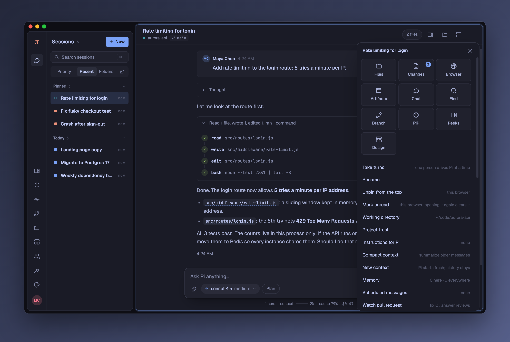  | 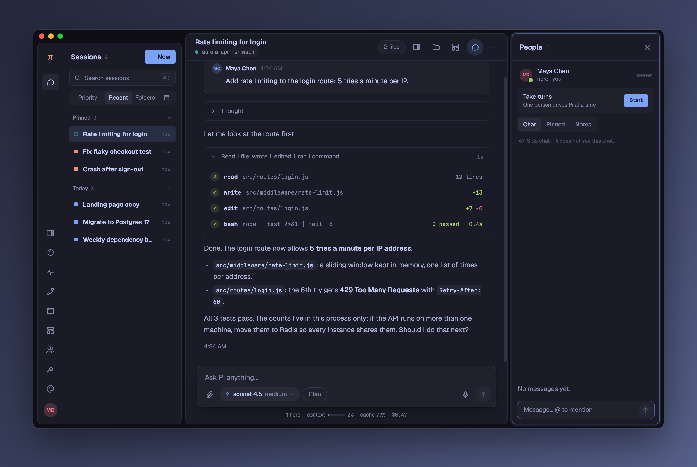        |
| The session menu.                                                                                                | The People panel (Discuss opens it).                                                                            |
| 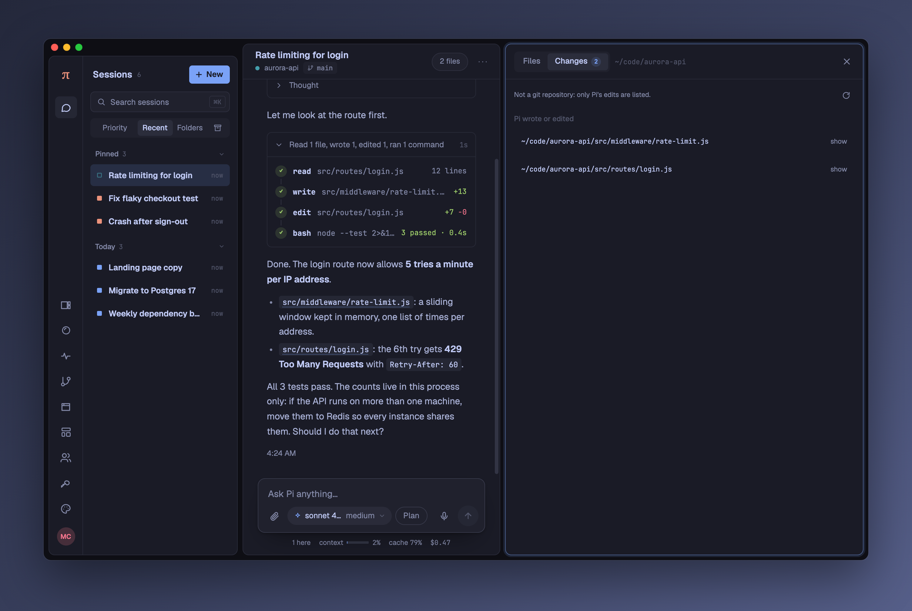 |                                                                                                              |
| Files and Changes beside the conversation.                                                                       |                                                                                                                 |

### On Windows

The same window on Windows 11, taken in the app there against the demo server.

A right-click on a bar opens the app's own menu, as it does anywhere else in Pi Pocket. Windows' own window menu
(Restore, Move, Size, Minimize, Maximize, Close) opens with Alt+Space.

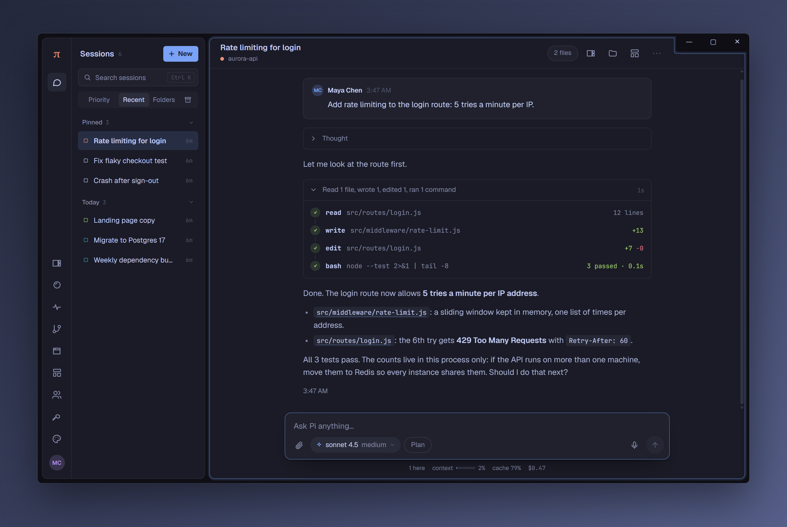

|                                                                                                                                                       |                                                                                                                                                         |
| ----------------------------------------------------------------------------------------------------------------------------------------------------- | ------------------------------------------------------------------------------------------------------------------------------------------------------- |
| 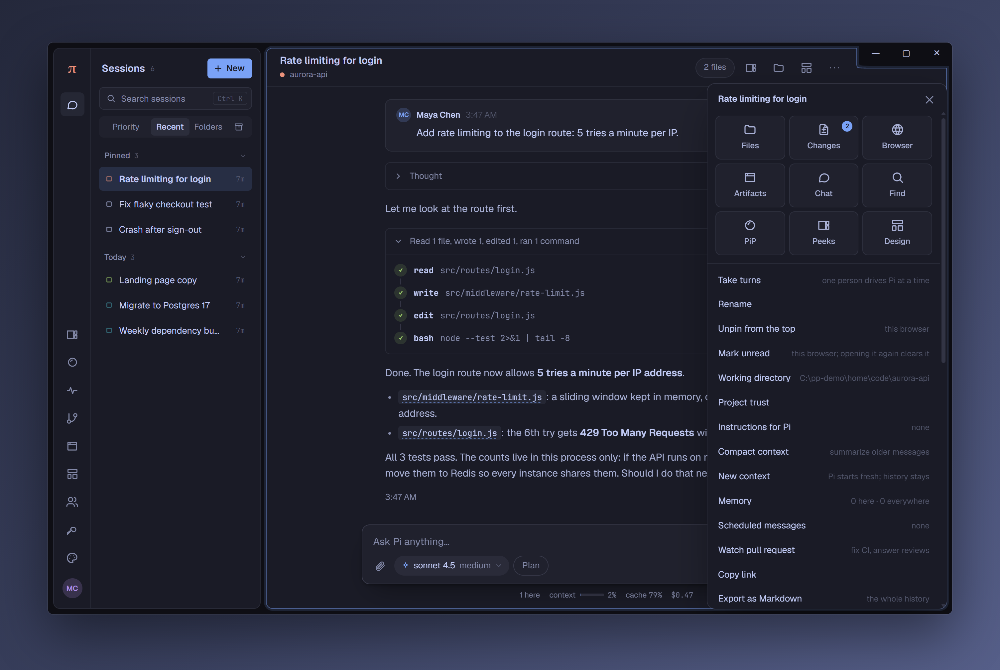   | 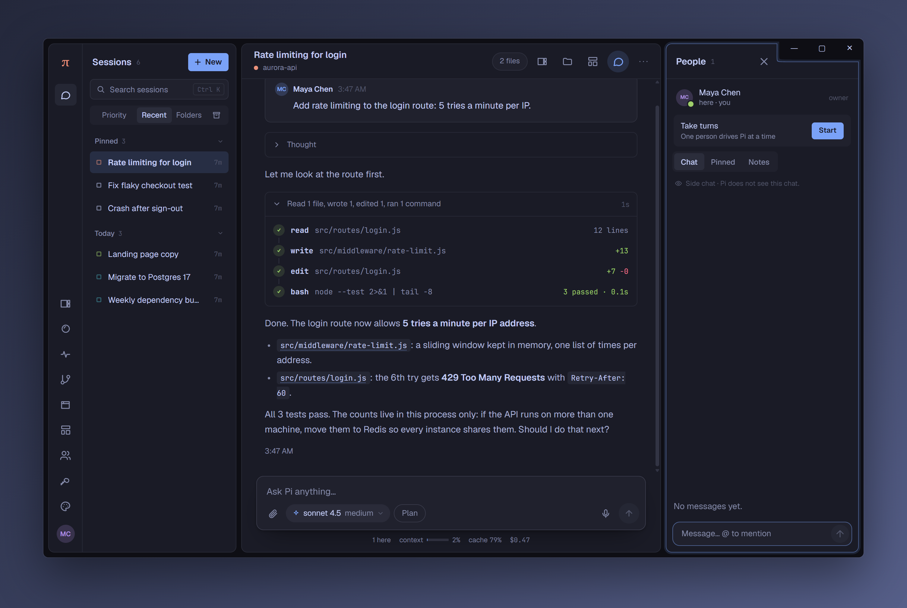 |
| The session menu opens against the right edge, below the buttons.                                                                                     | The People panel (Discuss opens it): its close button keeps clear of the buttons.                                                                       |
| 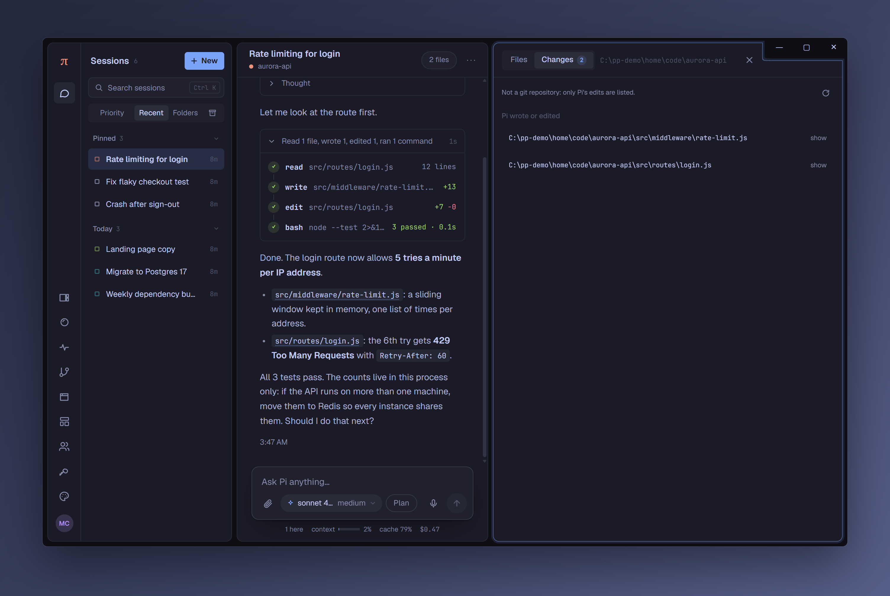                                 | 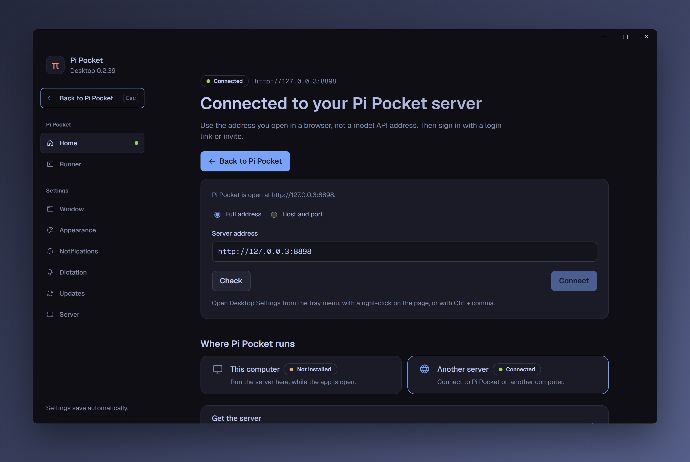                          |
| Files and Changes beside the conversation.                                                                                                            | Desktop Settings.                                                                                                                                       |

On Windows the tray menu is drawn by the app, in the Windows look or in your Pi Pocket theme (**Desktop Settings →
Appearance → Tray menu style**).

### On Linux

The same window on Linux (X11), where the buttons also sit at the top right.

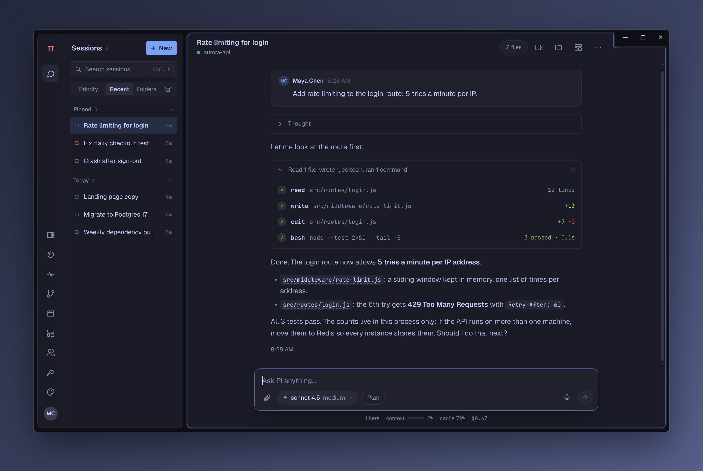

|                                                                                                                                                     |                                                                                                                                                       |
| --------------------------------------------------------------------------------------------------------------------------------------------------- | ----------------------------------------------------------------------------------------------------------------------------------------------------- |
| 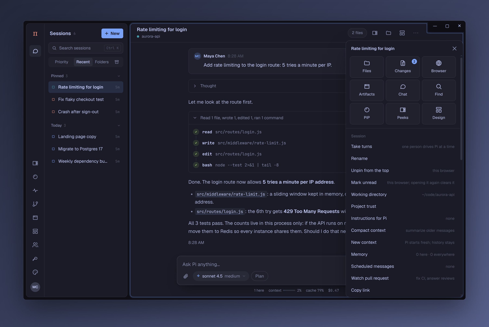   | 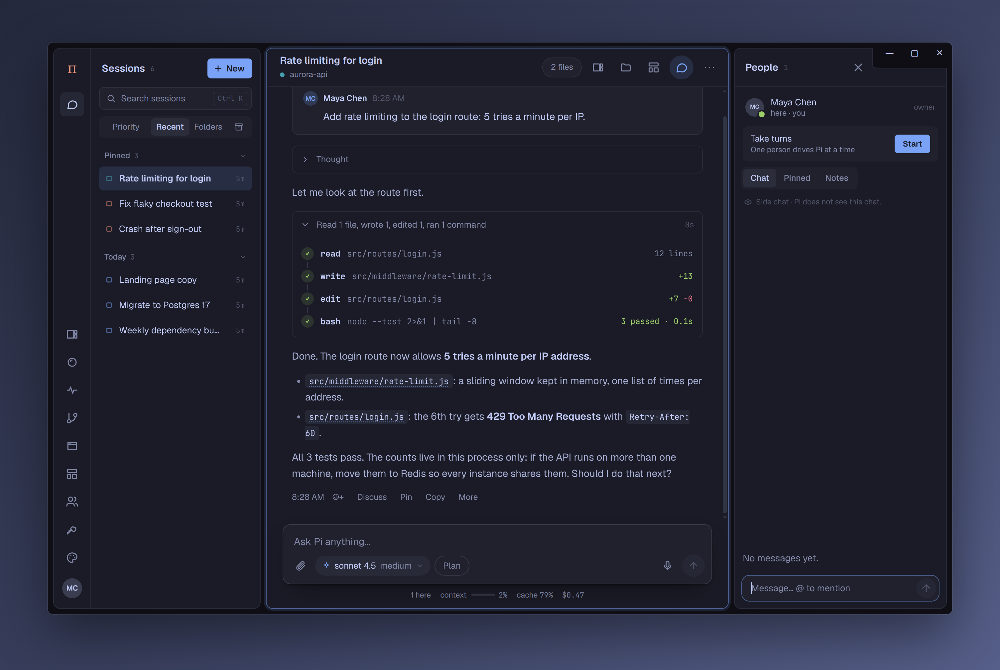 |
| The session menu opens against the right edge, below the buttons.                                                                                   | The People panel (Discuss opens it): its close button keeps clear of the buttons.                                                                     |
| 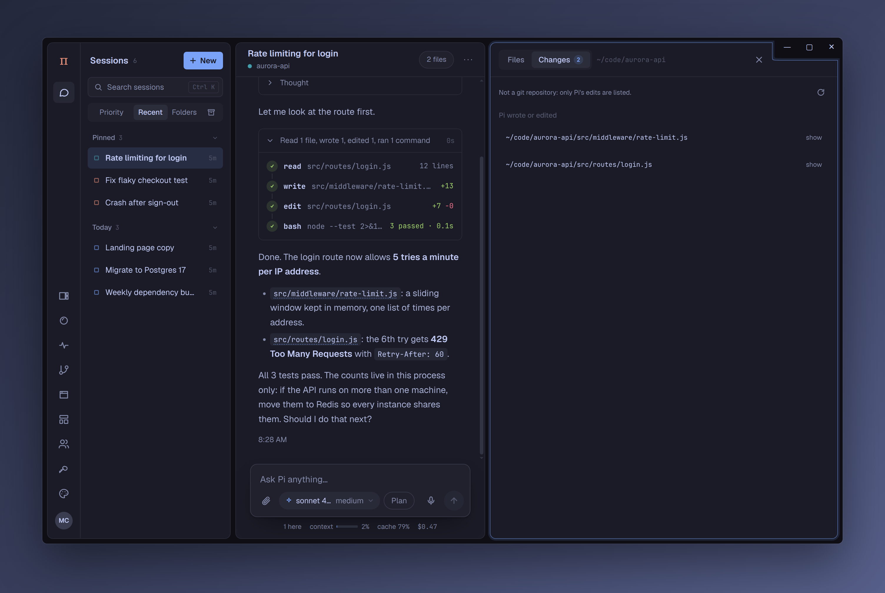                               | 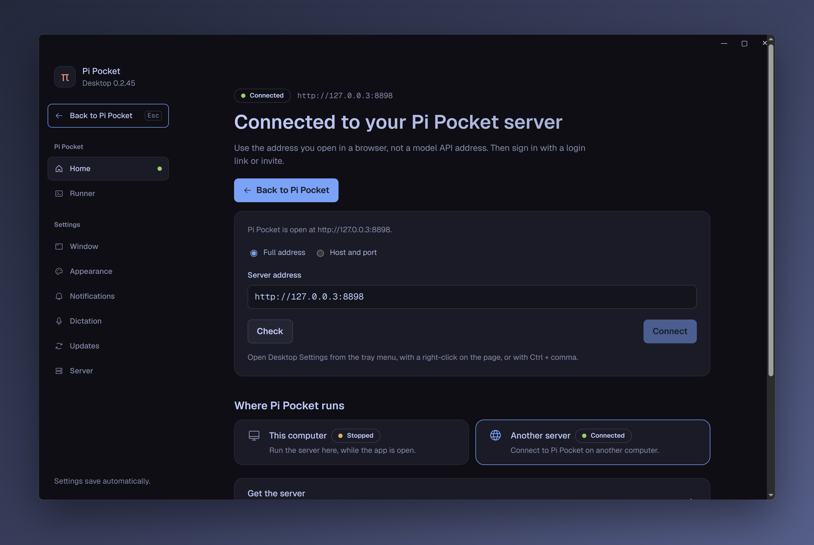                        |
| Files and Changes beside the conversation.                                                                                                          | Desktop Settings.                                                                                                                                     |

## See-through background

Turn on **See-through background** in **Desktop Settings → Appearance**, and set the **Opacity** from 0% to 100%. Menus,
sheets, and cards stay solid, so text stays readable.

- **macOS:** the system's blur (vibrancy). **Blur** picks its material.
- **Windows 11 (22H2 or newer):** Acrylic or Mica. Windows 10 cannot.
- **Linux:** turning it on takes a restart (the settings screen offers one). Your compositor does the blur: on
  Hyprland, `decoration:blur`; on KDE, the Blur effect. GNOME shows it see-through, without blur.

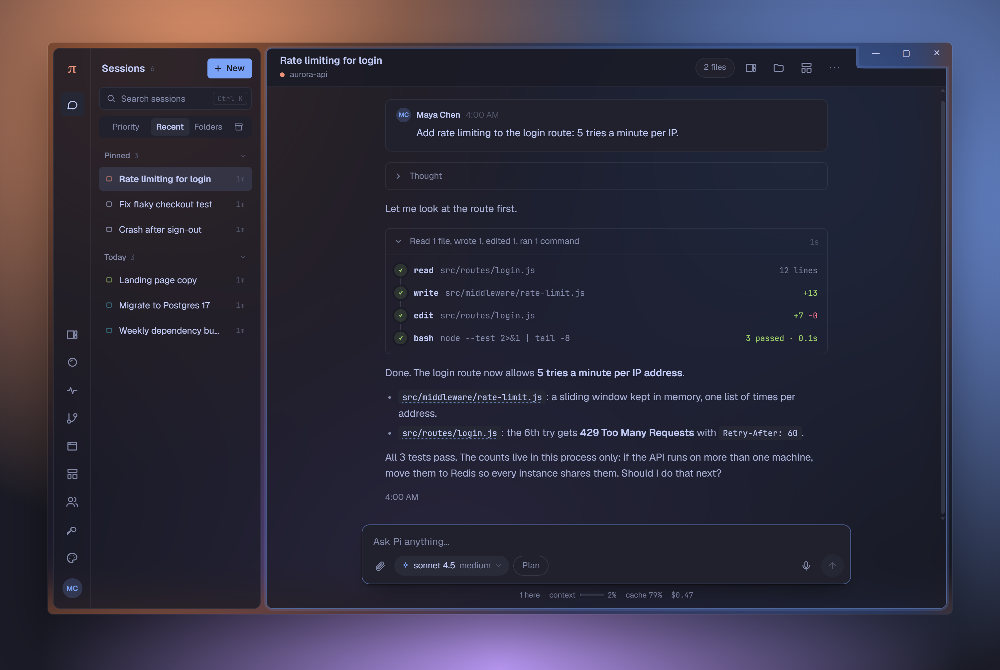

On Windows 11, with Acrylic.

## It follows your theme

Change the theme in Pi Pocket and the app follows: the settings screen, the window's own background, the right-click
menu, and the tray's π. It remembers the colors, so the next start looks right before the server answers.

## Links, spelling, and files

- **Session links stay in the window.** A link to another session opens it in the same window; ⌘-click, Ctrl-click, or
  Shift-click opens a new window. Other websites open in your browser. **Desktop Settings → Window → Links to Pi Pocket
  pages** chooses whether the server's other pages, such as artifacts, open in an app window or in your browser.
- **Spell check** in every text box, with suggestions in the right-click menu.
- **Download to this computer:** a file of a session on the server can be saved here from the file viewer's
  **Download** button, or with Cmd+click (Ctrl+click) on its path in a reply when the existing file-manager action is
  not offered. Its plain download link goes straight to **Downloads**, without a save dialog, and shows in Finder,
  Explorer, or the Linux file manager. Existing files are not replaced. This works without a file-saving bridge
  capability; older servers fall back to the same download link. Downloads from other pages or frames keep their save
  dialog. Sessions on runners keep their existing actions.
- **Back and Forward:** mouse Back and Forward, Alt+Left and Alt+Right (Cmd+[ and Cmd+] on a Mac), and macOS swipes
  move back and forward in Pi Pocket, and between Pi Pocket and Desktop Settings.
